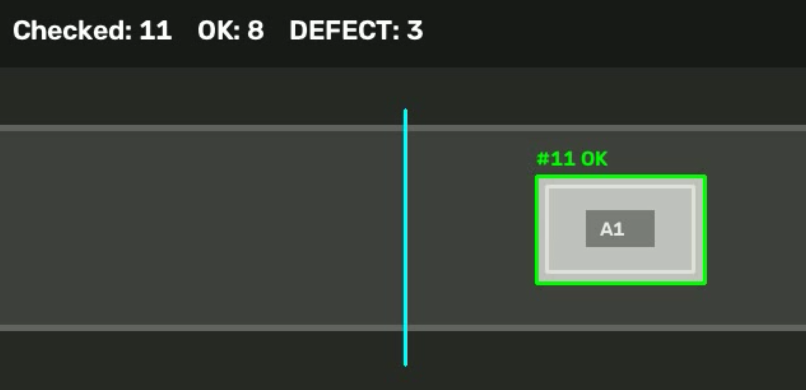
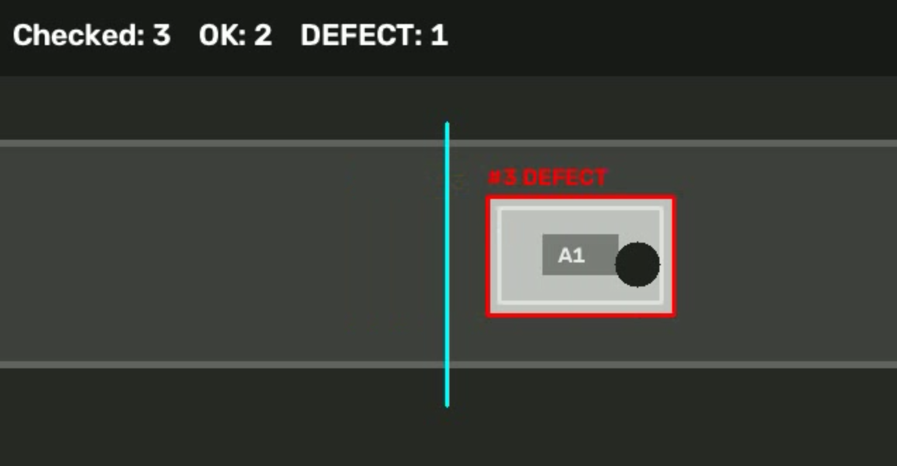

# Factory Defect Inspection

**Computer Vision | Industrial Automation | Quality Inspection**

A Python and OpenCV demonstration that inspects products moving along a conveyor belt. It detects and tracks individual products, compares them with a **known-good reference image**, labels each item **OK** or **DEFECT**, and exports an annotated video and a CSV inspection report.

> **Project scope:** This is a portfolio-scale, rule-based computer vision baseline using a **synthetic conveyor demo**—not a trained deep-learning model or a production-ready industrial inspection system.

## Demo preview

| Acceptable product | Defective product |
| --- | --- |
|  |  |

## Demo evaluation

The included synthetic test contains **12 labeled products**: **9 acceptable** and **3 defective**. Using these demo items, the inspection program reported:

| Metric | Result |
| --- | ---: |
| Accuracy | 100% |
| Precision | 100% |
| Recall | 100% |
| F1 score | 100% |

**Confusion matrix** (rows: actual OK / DEFECT; columns: predicted OK / DEFECT):

```text
[[9, 0],
 [0, 3]]
```

These figures measure performance **only on the included synthetic samples** and must not be interpreted as accuracy on real factory footage.

## Tech stack

- **Python 3.11**
- **OpenCV** — video processing, segmentation, contours, annotations
- **NumPy** — pixel-level image comparison
- **Pandas** — CSV reports
- **scikit-learn** — optional evaluation metrics

## Run the demo (Windows PowerShell)

Open a terminal in the project directory and run:

```powershell
py -3.11 -m venv .venv
.\.venv\Scripts\python.exe -m pip install -r requirements.txt
.\.venv\Scripts\python.exe make_demo.py
.\.venv\Scripts\python.exe defect_inspection.py --video data/factory_demo.mp4 --reference data/good_product.png --truth data/demo_ground_truth.csv --output outputs --no-show
```

> The main script is named `defect_inspection.py` (not `inspect.py`) to avoid a naming conflict with Python's standard-library `inspect` module.

### Generated files

| File | Description |
| --- | --- |
| `data/factory_demo.mp4` | Generated conveyor belt test video |
| `data/good_product.png` | Reference image of an acceptable product |
| `data/demo_ground_truth.csv` | Labels for synthetic evaluation |
| `outputs/inspection_result.mp4` | Annotated inspection video with item IDs and OK/DEFECT labels |
| `outputs/inspection_report.csv` | Inspection results, including item status and timestamps |

## How it works

1. Convert video frames to grayscale and separate light-colored products from the darker conveyor belt.
2. Find sufficiently large product candidates using contours.
3. Track approximate product identities between frames using centroid distance.
4. Inspect each item when it crosses the virtual inspection line.
5. Compare the cropped product against a known-good reference and classify it using a changed-pixel ratio threshold.
6. Save an annotated video and a CSV report; optionally evaluate predictions against known labels.

## Using your own video

Capture footage from a **fixed, top-down camera** with consistent lighting, product size, and orientation. Place the video at `data/my_conveyor.mp4` and provide a cropped reference image at `data/good_product.png`.

```powershell
.\.venv\Scripts\python.exe defect_inspection.py --video data/my_conveyor.mp4 --reference data/good_product.png --output outputs --threshold 100 --defect-threshold 0.04 --no-show
```

Adjust `--threshold`, `--min-area`, `--pixel-threshold`, and `--defect-threshold` to suit the camera and products. See `--help` for the full set of command-line arguments.

## Limitations and safety

This baseline assumes one product type, similar scale and rotation, a stable camera, and strong product/background contrast. Shadows, occlusions, changing conveyor speeds, touching products, misalignment, and complex three-dimensional defects may reduce reliability.

The synthetic evaluation does **not** validate the system for industrial use. Do not connect this prototype to a physical rejection mechanism without appropriate engineering, industrial safety measures, and real-world testing.
